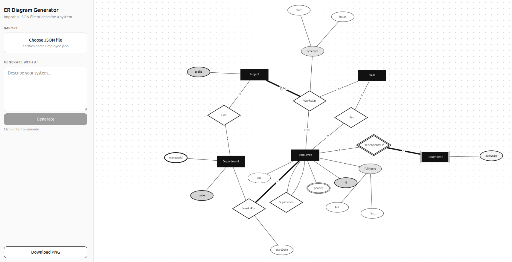

# ER Diagram Generator

Turn a JSON file or a plain-English description into an interactive Entity-Relationship diagram in Chen notation.

Built for **Database Systems (Lab 1)**, Computer and Systems Engineering, Faculty of Engineering, Alexandria University, with React, Spring Boot, Cytoscape.js and Gemini.



## Table of contents

- [Features](#features)
- [How it works](#how-it-works)
- [Tech stack](#tech-stack)
- [Getting started](#getting-started)
- [Configuration](#configuration)
- [JSON format](#json-format)
- [Validation rules](#validation-rules)
- [Diagram legend](#diagram-legend)
- [API reference](#api-reference)
- [Example prompt](#example-prompt)
- [Project structure](#project-structure)
- [Design decisions](#design-decisions)
- [Troubleshooting](#troubleshooting)
- [Roadmap](#roadmap)
- [Author](#author)

## Features

- **Import JSON**: upload a file describing entities and relationships and see the diagram instantly. No backend needed.
- **Generate with AI**: describe a system ("a hospital with patients, doctors and appointments") and Gemini produces the diagram.
- **Full Chen notation**: weak entities, identifying relationships, composite / multivalued / derived attributes, primary and partial keys, total vs partial participation, cardinality labels, recursive and ternary relationships, and relationship attributes.
- **Parallel edges** (for example a recursive relationship) are drawn as separate curves instead of overlapping.
- **Export** the diagram as a PNG.
- **Readable errors**: duplicate names, unknown entities in relationships and malformed files are reported with a clear message instead of a crash.
- **Default diagram** shown on load, so the app is never empty.

## How it works

```
JSON file ───────────────┐
                         ├─> Erdiagram ─> mapErdToGraph ─> Graph ─> Cytoscape elements ─> canvas
Prompt ─> Spring Boot ───┘
          └─> Gemini
```

1. The **backend** only talks to Gemini. It builds the prompt, calls the model, and returns the ER JSON unchanged.
2. The **frontend** owns the mapping from the ER description to a graph (`mapErdToGraph`), so uploaded files and AI output follow exactly the same path.
3. `useDiagram` holds the single source of truth (the graph). Cytoscape elements are derived from it with `useMemo`, so they only rebuild when the graph changes.
4. `GraphCanvas` renders the elements with the stylesheet in `graphStyles.ts` and the `fcose` layout in `layouts.ts`.

## Tech stack

| Layer    | Tools                                                  |
|----------|--------------------------------------------------------|
| Frontend | React, TypeScript, Vite, Cytoscape.js, cytoscape-fcose |
| Backend  | Java 21, Spring Boot 4, Google Gen AI SDK, Jackson     |
| AI       | Gemini (model name configurable)                       |

## Getting started

### Prerequisites

- Node.js 18 or newer
- JDK 21
- A Gemini API key from [Google AI Studio](https://aistudio.google.com) (only needed for AI generation)

### 1. Clone

```bash
git clone https://github.com/AhmedElmansy2004/ERD-class-diagram-drawer.git
cd ERD-class-diagram-drawer
```

### 2. Backend

```bash
cd backend/erdiagram
export GEMINI_API_KEY=your_key_here
./mvnw spring-boot:run
```

The API starts on `http://localhost:8080`. On Windows use `mvnw.cmd` and `set GEMINI_API_KEY=your_key_here`.

### 3. Frontend

```bash
cd frontend
npm install
npm run dev
```

Open the URL Vite prints (usually `http://localhost:5173`).

### 4. Try it

- Click **Choose JSON file** and upload `samples/test-all.json`. It covers every feature.
- Or paste the [example prompt](#example-prompt) into the AI box and press **Generate** (or Ctrl + Enter).

## Configuration

| Setting          | Where                                   | Notes                                                       |
|------------------|-----------------------------------------|-------------------------------------------------------------|
| `GEMINI_API_KEY` | environment variable                    | Required for AI generation. Never commit it.                |
| Gemini model     | `application.properties` (`GeminiProperties`) | Change it here when a model is deprecated or out of quota. |
| CORS origins     | `config/CorsConfig.java`                | Must include the frontend URL (default Vite port 5173).     |
| Backend URL      | `frontend/src/hooks/useDiagram.ts`      | Defaults to `http://localhost:8080`.                        |

## JSON format

```json
{
  "entities": [
    {
      "name": "Employee",
      "isWeak": false,
      "attributes": [
        { "name": "id", "keyType": "PRIMARY_KEY", "attributeType": "ATTRIBUTE" },
        {
          "name": "fullName",
          "keyType": "NONE",
          "attributeType": "COMPOSITE_ATTRIBUTE",
          "composite": [
            { "name": "first", "keyType": "NONE", "attributeType": "ATTRIBUTE" },
            { "name": "last", "keyType": "NONE", "attributeType": "ATTRIBUTE" }
          ]
        }
      ]
    },
    {
      "name": "Department",
      "isWeak": false,
      "attributes": [
        { "name": "code", "keyType": "PRIMARY_KEY", "attributeType": "ATTRIBUTE" }
      ]
    }
  ],
  "relationships": [
    {
      "name": "WorksFor",
      "isIdentifying": false,
      "entities": [
        { "name": "Employee", "cardinality": "N", "participation": "TOTAL" },
        { "name": "Department", "cardinality": "1", "participation": "PARTIAL" }
      ],
      "attributes": [
        { "name": "startDate", "keyType": "NONE", "attributeType": "ATTRIBUTE" }
      ]
    }
  ]
}
```

### Fields

**Entity**

| Field        | Type        | Required | Notes                       |
|--------------|-------------|----------|-----------------------------|
| `name`       | string      | yes      | Unique across all entities  |
| `isWeak`     | boolean     | yes      | Weak entities get a double border |
| `attributes` | Attribute[] | yes      | May be empty                |

**Attribute**

| Field           | Type        | Required | Values                                                                           |
|-----------------|-------------|----------|----------------------------------------------------------------------------------|
| `name`          | string      | yes      | Unique among its siblings                                                        |
| `keyType`       | string      | yes      | `PRIMARY_KEY`, `PARTIAL_KEY`, `FOREIGN_KEY`, `NONE`                              |
| `attributeType` | string      | yes      | `ATTRIBUTE`, `MULTIVALUED_ATTRIBUTE`, `COMPOSITE_ATTRIBUTE`, `DERIVED_ATTRIBUTE` |
| `composite`     | Attribute[] | no       | Sub-attributes, for composite attributes (can nest)                              |

**Relationship**

| Field           | Type                 | Required | Notes                                           |
|-----------------|----------------------|----------|-------------------------------------------------|
| `name`          | string               | yes      | May repeat across relationships                 |
| `isIdentifying` | boolean              | yes      | `true` for a weak entity's identifying relationship |
| `entities`      | RelationshipEntity[] | yes      | Two or more; list an entity twice for a recursive relationship |
| `attributes`    | Attribute[]          | no       | Attributes of the relationship itself           |

**RelationshipEntity**

| Field                | Type   | Required | Notes                                              |
|----------------------|--------|----------|----------------------------------------------------|
| `name`               | string | yes      | Must match an entity name                          |
| `cardinality`        | string | yes      | Usually `"1"`, `"N"` or `"M"`                      |
| `participation`      | string | no       | `TOTAL` or `PARTIAL` (defaults to `PARTIAL`)       |
| `participationLimit` | string | no       | Minimum, shown as `(min,max)` on the edge label    |

## Validation rules

The mapper throws a descriptive error (shown in the red message box) when:

- two entities share a name,
- two sibling attributes share a name (in an entity, a relationship or a composite),
- a relationship refers to an entity that does not exist,
- a node id would be duplicated.

Relationship names may repeat. Each relationship gets an id based on its position (`rel:0:WorksFor`), and each of its edges is numbered, so recursive relationships and duplicate names never collide.

Node ids use full paths (`Employee.fullName.first`), so the same attribute name in two entities stays unique.

## Diagram legend

| Element                  | Look                  |
|--------------------------|-----------------------|
| Entity                   | black rectangle       |
| Weak entity              | double border         |
| Relationship             | diamond               |
| Identifying relationship | double-border diamond |
| Attribute                | ellipse               |
| Primary key              | **bold** label        |
| Partial key              | *italic* label        |
| Foreign key              | thicker border        |
| Multivalued attribute    | double border         |
| Derived attribute        | dashed border         |
| Composite attribute      | gray fill             |
| Total participation      | thick line            |
| Cardinality              | label on the edge, `N`, or `(min,max)` with a limit |

## API reference

### `POST /api/generate`

Generates an ER diagram from a text description.

**Request**

```json
{ "description": "A hospital with patients, doctors and appointments" }
```

**Success (200)**: the ER JSON described in [JSON format](#json-format).

**Errors**: a JSON body of the form `{ "message": "..." }`.

| Status | Meaning                                                              |
|--------|----------------------------------------------------------------------|
| 500    | `GEMINI_API_KEY` is not set                                          |
| 502    | Gemini returned an empty response or the request failed              |
| 503    | The model is overloaded (503) or the quota is exhausted (429)        |

## Example prompt

```
Design an ER diagram for a hospital database.

Entities:
- Patient: patientId (primary key), fullName (composite: firstName, lastName), phones (multivalued), birthDate, age (derived from birthDate).
- Doctor: doctorId (primary key), name, specialty.
- Department: deptCode (primary key), deptName.
- Appointment: appointmentId (primary key), date, time.
- Room: roomNumber (primary key), floor.
- Prescription (weak entity, depends on Appointment): prescriptionNo (partial key), notes.
- Medicine: medicineId (primary key), name.

Relationships:
- Doctor works for exactly one Department. A department has many doctors, and every doctor must belong to one.
- A Patient books many Appointments. Every appointment must have a patient.
- A Doctor attends many Appointments. Every appointment must have a doctor.
- Prescription is identified by its Appointment (identifying relationship). Each appointment can have many prescriptions, and every prescription belongs to exactly one appointment.
- Doctor supervises other Doctors (recursive): one supervisor has many supervisees.
- Prescription includes Medicine (many-to-many), with the attribute dosage on the relationship.
- Patient is admitted to Room under a Doctor (ternary relationship), with the attribute admissionDate.
```

Naming key types, cardinalities and "must / can" participation gives the model direct answers, so it does not have to guess.

## Project structure

```
backend/erdiagram/
  src/main/java/com/mansy/erdiagram/
    ai/            GeminiClient, GeminiProperties, PromptBuilder
    api/           GenerateController, DiagramController, dto/
    config/        CorsConfig
    exception/     GenerationException, GlobalExceptionHandler, InvalidErdException
    mapper/        ErdToGraphMapper (server-side mapper, not used by the current flow)
    models/        erd/ and graph/ records and enums
    validators/    ErdValidator
  src/main/resources/application.properties

frontend/src/
  components/
    graph/         GraphCanvas, graphStyles, layouts
    layout/        AppShell, Sidebar, layout.css
    panels/        JsonUploadPanel, PromptPanel, panels.css
  hooks/           useDiagram, useCytoscape
  types/           erdiagram.ts (input format), graph.ts (graph model)
  utils/           erdMapper.ts, toCytoscapeElements.ts, download.ts
  mocks/           hardcodedGraph.ts (default diagram)

samples/           test-all.json (covers every feature)
docs/              screenshots and notes
```

## Design decisions

- **Mapping on the frontend.** The ER JSON is the single input format. Uploaded files and AI output share one code path, and errors surface instantly with no round trip. The backend stays a thin wrapper around the model.
- **One owner for the graph.** `useDiagram` holds the graph, and elements are derived with `useMemo`. Components never keep a second copy that could drift out of sync.
- **Plain mapper functions.** `mapErdToGraph` is a pure function with no hooks, so it is easy to test: same input, same output.
- **Stable, content-based ids.** Ids come from what the thing is (`Employee.id`), not from a counter, so rebuilding the graph after a change never shifts them.
- **Validate at the boundary.** The mapper runs inside event handlers, not during render, so a bad file becomes an error message instead of a blank screen.
- **Errors split by cause.** Quota and overload errors from Gemini map to 503 with a friendly message, and other failures map to 502.

## Troubleshooting

| Symptom                                   | Cause and fix                                                                                                   |
|-------------------------------------------|-----------------------------------------------------------------------------------------------------------------|
| `429 RESOURCE_EXHAUSTED` in the backend log | Daily free-tier quota for that model is used up. Switch to another model in `application.properties`, or enable billing. Retrying will not help. |
| `503 UNAVAILABLE` (high demand)           | Temporary overload. Wait a little and try again.                                                                |
| "GEMINI_API_KEY is not set"               | Export the variable in the same terminal that starts the backend.                                               |
| Generate shows an empty or odd diagram    | Check that the backend returns the `entities` / `relationships` shape, not the old `nodes` / `edges` shape.     |
| Browser CORS error                        | Add the frontend origin to `CorsConfig`.                                                                        |
| Layout warning about "invalid endpoints"  | All nodes start at the same point when the layout begins. Harmless once the layout runs; seeding random starting positions removes it. |
| Upload shows "File must contain ..."      | The JSON needs top-level `entities` and `relationships` arrays.                                                 |
| Keys are not bold or italic               | `toCytoscapeElements` must copy `key` into each node's `data`.                                                  |

## Roadmap

- Lab 2: convert the ER diagram to a relational model
- Class diagram support
- Persistent storage for diagrams
- Editing the diagram in the UI (adding and removing attributes)
- Runtime validation (a schema check) for uploaded and generated JSON

## Author

Ahmed ElMansy, Computer and Systems Engineering, Faculty of Engineering, Alexandria University.